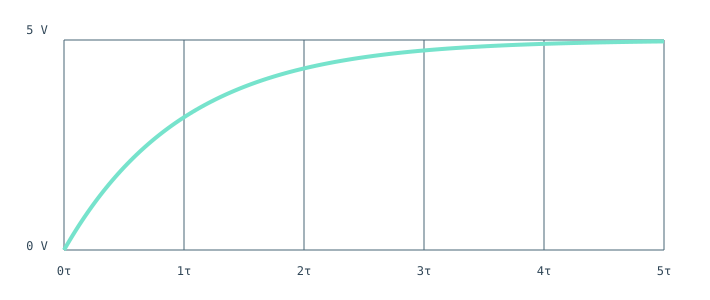

# Circuito RC

Um simulador em Python para investigar quanto tempo um capacitor leva para carregar ou descarregar através de um resistor. Gera um gráfico que abre no navegador e uma planilha CSV com tempo, tensão e corrente.



## Executar

Com Python 3.8 ou superior, abra o terminal na pasta do projeto. No Windows, execute:

```powershell
py simular.py
```

Abra `resultado/curva.html` no navegador. O arquivo `amostras.csv` fica na mesma pasta. Em Linux ou macOS, use `python3` no lugar de `py`. O programa usa apenas a biblioteca padrão.

## Experimento

O exemplo inicial usa 10 kΩ, 100 µF e 5 V. A constante de tempo é τ = R × C = 1 segundo. Após 1 segundo, a tensão chega a aproximadamente 3,16 V. Experimente dobrar a resistência:

```powershell
py simular.py --kohm 20 --uf 100 --volts 5 --saida resistencia-dupla
```

Abra o novo gráfico. A tensão de 3,16 V agora é atingida em 2 segundos. Os gráficos têm a mesma forma porque o eixo horizontal usa múltiplos de τ. A legenda mostra o tempo em segundos.

Para observar a descarga de um capacitor inicialmente a 5 V:

```powershell
py simular.py --modo descarga --saida descarga
```

## Modelo

Para um resistor e um capacitor ideais em série, a tensão segue V(t) = Vf + (Vi − Vf) exp(−t/τ). Na carga, Vi = 0 e Vf é a tensão da fonte. Na descarga, Vi é a tensão inicial e Vf = 0. A corrente é positiva quando entra no terminal positivo do capacitor. A simulação cobre cinco constantes de tempo e desconsidera fugas e tolerâncias dos componentes.

## Desenvolvimento

Projeto de estudo de Engenharia da Computação. A versão inicial do código e da documentação foi gerada com o ChatGPT.
